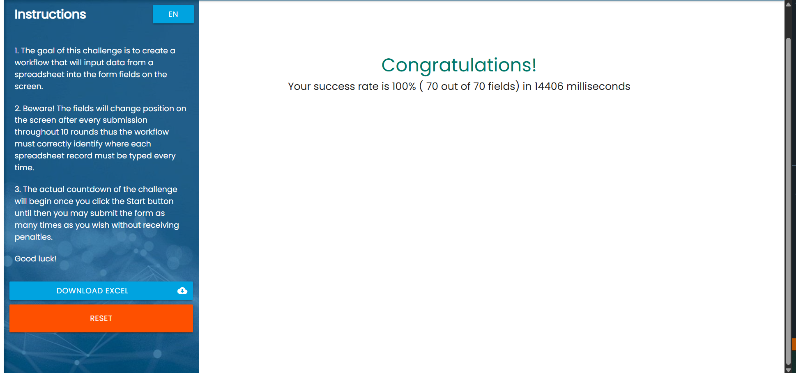
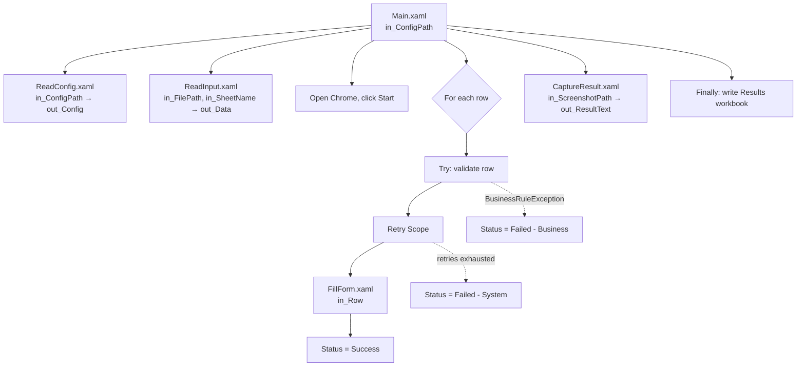

# RPA Challenge – Input Forms (UiPath)

A UiPath robot that completes the **Input Forms** challenge at [rpachallenge.com](https://rpachallenge.com): it reads ten people from an Excel file and types each one into a web form whose fields change position after every submission.

The challenge itself is small. This project solves it the way a production process is built: the input is configured rather than hard-coded, every row is handled and logged on its own, one bad row cannot stop the run, and the robot writes a report of what it did.

## Result



**100% success rate (70 of 70 fields) in 14,406 ms**, measured by the challenge page on a real run. The screenshot is taken by the robot itself at the end of the run.

The time is higher than a speed-optimised solution because each row runs inside its own error handling, retry scope and logging. That trade-off is deliberate.

## What it does

1. Reads its settings from `Config\Config.xlsx`.
2. Reads the people from the input workbook named in the config, and checks the file before using it.
3. Opens the challenge page in Chrome and clicks **Start**.
4. For each person: checks the row is complete, fills the seven fields, clicks **Submit**, and records the outcome.
5. Reads the result message and saves a screenshot of the result page.
6. Writes a results workbook with a `Status` and `Message` column for every person.

## Features

| Feature | How it is done |
|---|---|
| Config-driven input | Input path, sheet name, output folder, URL and retry settings come from `Config\Config.xlsx`. `Main.xaml` takes one argument, `in_ConfigPath`, so a different config can be used without editing the workflow. |
| Input validation | `ReadInput.xaml` fails fast if the file is missing, a required column is absent or there are no data rows. It also trims column headers and drops blank rows. |
| Per-row error handling | Each row has its own Try Catch. A failed row is recorded and the loop moves on to the next person. |
| Business vs. system errors | A row with a missing value raises a `BusinessRuleException` and is **not** retried, because retrying cannot fix bad data. Any other failure is treated as a system error. |
| Retry | Filling and submitting the form runs inside a Retry Scope. The number of attempts and the wait between them come from the config. |
| Logging | Info for every submitted row, Error with the Excel row number for every failed row, Warn for each retried attempt. |
| Output report | `Output\Results_<timestamp>.xlsx` holds the input columns plus `Status` and `Message`. It is written in a Finally block, so it exists even if the run stops early. |
| Modular workflows | Five workflows, each with one job and explicit arguments. |
| Position-independent selectors | Each field is found through its label (`First Name`, `Email`, …), not through its position or its ID, both of which change every round. All selectors live in the Object Repository. |

## Architecture



| Workflow | Arguments | Responsibility |
|---|---|---|
| `Main.xaml` | `in_ConfigPath` (String, optional) | Orchestration only: config, input, loop, error handling, report. |
| `Workflows\ReadConfig.xaml` | `in_ConfigPath` → `out_Config` (Dictionary) | Reads the `Settings` sheet into a dictionary. |
| `Workflows\ReadInput.xaml` | `in_FilePath`, `in_SheetName` → `out_Data` (DataTable) | Reads and validates the input workbook. |
| `Workflows\FillForm.xaml` | `in_Row` (DataRow) | Types one person into the form and clicks Submit. |
| `Workflows\CaptureResult.xaml` | `in_ScreenshotPath` → `out_ResultText` (String) | Reads the result message and saves the screenshot. |

## Configuration

`Config\Config.xlsx`, sheet `Settings`:

| Name | Default | Meaning |
|---|---|---|
| `InputFilePath` | `Input\challenge.xlsx` | Workbook with the people to enter. Relative to the project folder, or absolute. |
| `InputSheetName` | `Sheet1` | Sheet that holds the data. |
| `OutputFolder` | `Output` | Folder for the results workbook and the screenshot. |
| `ChallengeUrl` | `https://rpachallenge.com/` | Address of the challenge page. |
| `MaxRetries` | `3` | Attempts per row before it is marked as failed. |
| `RetryIntervalSeconds` | `1` | Seconds to wait between attempts. |

## Output

A sample report from a real run is in [docs/sample_results.xlsx](docs/sample_results.xlsx). When one row has a blank Email, the report looks like this (other columns omitted):

| First Name | Last Name | Email | Status | Message |
|---|---|---|---|---|
| Michael | Robertson | mrobertson@mc.com | Success | |
| Doug | Derrick | | Failed - Business | Missing value for: Email |
| Jessie | Marlowe | jmarlowe@aperture.us | Success | |

The log for that run:

```
Info   Row 5: submitted Michael Robertson
Error  Row 6 failed (business rule, not retried): Missing value for: Email
Info   Row 7: submitted Jessie Marlowe
...
Warn   Result screen not captured: only 9 of 10 rows were submitted.
Info   Results written to ...\Output\Results_20261013_173315.xlsx
```

## How to run

**Requirements**

- Windows, UiPath Studio 2026.0 or later (Windows project, VB expressions)
- Google Chrome with the UiPath browser extension enabled
- Packages (restored automatically): `UiPath.System.Activities` 26.8.2, `UiPath.UIAutomation.Activities` 26.10.5, `UiPath.Excel.Activities` 3.6.1. Excel itself is not required.

**Steps**

1. Clone the repository and open `project.json` in UiPath Studio.
2. Run `Main.xaml`.
3. Find the report and the screenshot in the `Output` folder.

To use a different input file, change `InputFilePath` in `Config\Config.xlsx`, or pass another config file in `in_ConfigPath`.

## Project structure

```
Main.xaml                  orchestration
Workflows/
  ReadConfig.xaml
  ReadInput.xaml
  FillForm.xaml
  CaptureResult.xaml
Config/Config.xlsx         settings
Input/challenge.xlsx       input data from rpachallenge.com
Output/                    results and screenshots (not in source control)
docs/                      README image and sample report
.objects/                  Object Repository (UI selectors)
```
